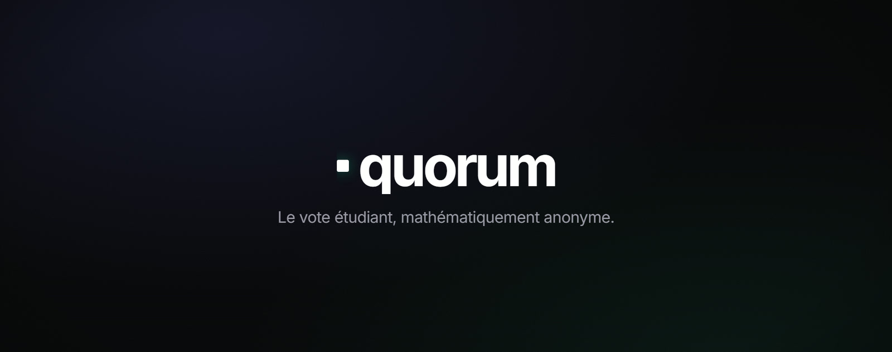
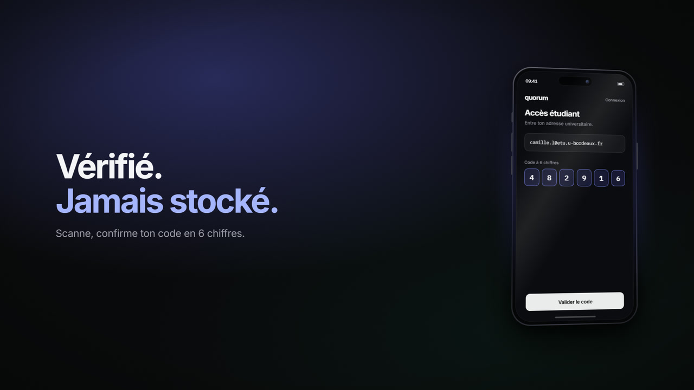
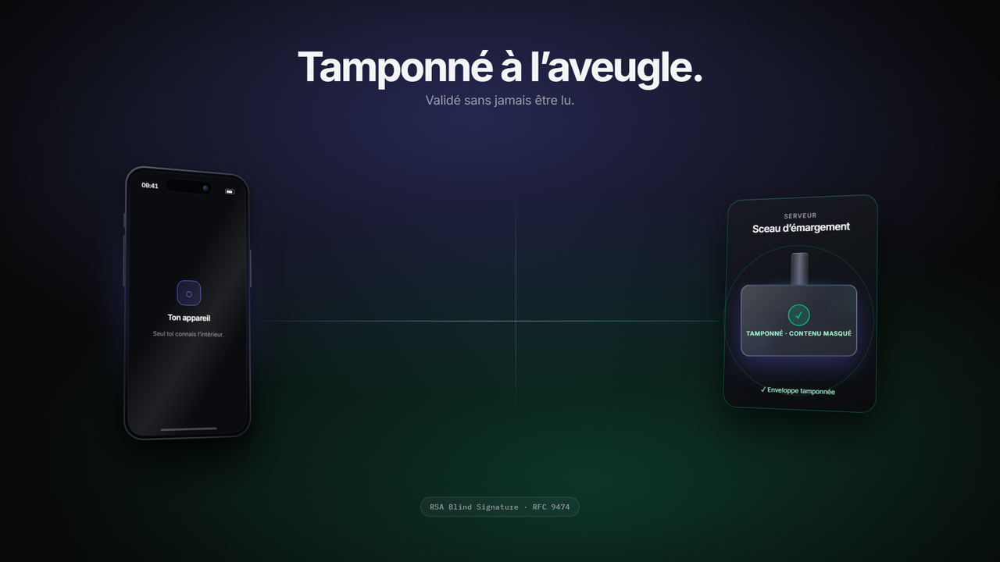
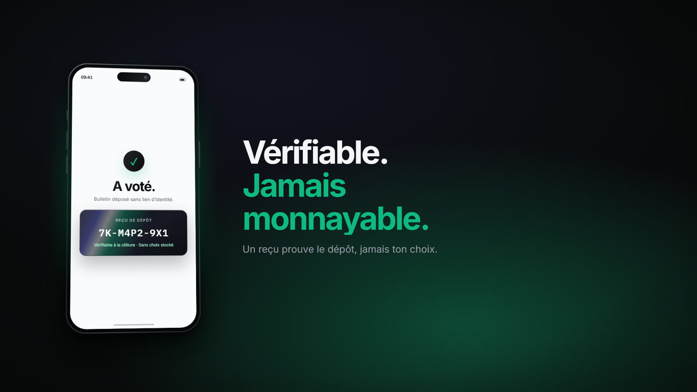
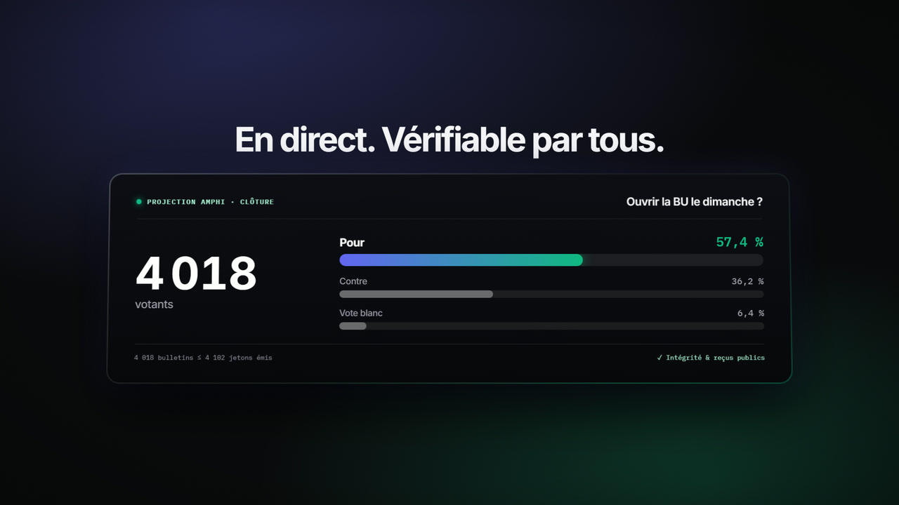
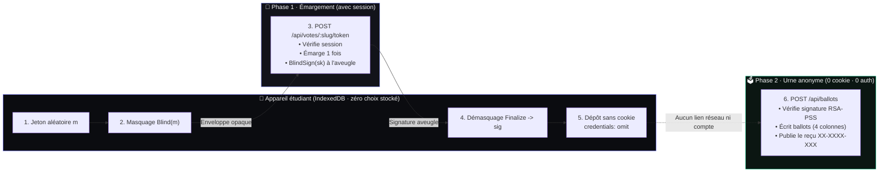

<div align="center">



<br />
<br />

<p>
  <strong>Plateforme web mobile-first de vote étudiant anonyme, vérifiable et auditable.</strong><br />
  <sub>Projet indépendant conçu par des étudiants pour la communauté étudiante de Bordeaux · Protocole RFC 9474 (Blind RSA)</sub>
</p>

<p>
  <a href="https://github.com/essaim-libre/quorum/actions/workflows/ci.yml">
    
  </a>
  
  
  
  
  
</p>

<p>
  <a href="#-aperçu-visuel--démo"><strong>🎬 Démo &amp; Captures</strong></a>
  &nbsp;·&nbsp;
  <a href="#-pourquoi-quorum-"><strong>⚡ Fonctionnalités</strong></a>
  &nbsp;·&nbsp;
  <a href="#-protocole-de-vote-anonyme-rfc-9474"><strong>🔐 Protocole RFC 9474</strong></a>
  &nbsp;·&nbsp;
  <a href="#️-sécurité--11-invariants"><strong>🛡️ Sécurité</strong></a>
  &nbsp;·&nbsp;
  <a href="#-démarrage-rapide"><strong>🚀 Démarrage rapide</strong></a>
  &nbsp;·&nbsp;
  <a href="#-documentation"><strong>📚 Docs</strong></a>
</p>

</div>

---

## 🎬 Aperçu visuel & démo

<!--
  🎥 POUR JOUER LA VIDÉO DE LANCEMENT DIRECTEMENT DANS CE README (SANS ALOURDIR GIT) :
  1. Ouvrez ce README en édition sur GitHub (ou un commentaire d'issue sur le dépôt).
  2. Glissez-déposez votre fichier local `video/out/quorum-launch-1080p60.mp4`.
  3. GitHub génère automatiquement une URL `https://github.com/user-attachments/assets/...`.
  4. Collez cette URL sur une ligne seule juste en dessous de ce commentaire : GitHub affichera un lecteur vidéo MP4 natif.
-->

<table>
  <tr>
    <td width="50%" valign="top">
      
      <br />
      <strong>🔐 01 · Vérifié, jamais stocké</strong><br />
      <sub>Scan QR en amphi, adresse <code>@etu.u-bordeaux.fr</code> et code OTP à 6 chiffres. L’e-mail est immédiatement réduit en empreinte HMAC et n’est jamais stocké en clair.</sub>
    </td>
    <td width="50%" valign="top">
      
      <br />
      <strong>✉️ 02 · Tamponné à l’aveugle (RFC 9474)</strong><br />
      <sub>Le téléphone masque le jeton dans une enveloppe cryptographique opaque. Le serveur émarge et signe à l’aveugle sans jamais pouvoir relier le bulletin à l’étudiant.</sub>
    </td>
  </tr>
  <tr>
    <td width="50%" valign="top">
      
      <br />
      <strong>🗳️ 03 · Vérifiable, jamais monnayable</strong><br />
      <sub>Bulletin envoyé sans cookie (<code>credentials: "omit"</code>). Revote libre jusqu’à l’échéance et reçu public <code>7K-M4P2-9X1</code> sans jamais enregistrer le choix sur l’appareil.</sub>
    </td>
    <td width="50%" valign="top">
      
      <br />
      <strong>🏛️ 04 · Mode amphi &amp; PV vérifiable</strong><br />
      <sub>Projection temps réel en amphithéâtre sans aucun résultat partiel avant clôture. À l’échéance : dépouillement public, contrôle <code>bulletins ≤ jetons</code> et procès-verbal PDF.</sub>
    </td>
  </tr>
</table>

---

## ⚡ Pourquoi Quorum ?

<table>
  <tr>
    <td width="50%" valign="top">
      <h3>🕶️ Anonymat mathématique</h3>
      Signature aveugle <strong>RSABSSA-SHA384-PSS-Randomized</strong> (<code>@cloudflare/blindrsa-ts</code>) avec une paire RSA 2048 dédiée par scrutin, chiffrée en AES-256-GCM puis <strong>effacée définitivement à la clôture</strong>.
    </td>
    <td width="50%" valign="top">
      <h3>🧾 Preuve sans coercition</h3>
      Chaque votant reçoit un code Crockford Base32 (<code>XX-XXXX-XXX</code>) vérifiable dans la liste publique post-clôture. Le reçu prouve le dépôt, <strong>jamais l’option choisie</strong> ; le revote reste libre jusqu’à la fin.
    </td>
  </tr>
  <tr>
    <td width="50%" valign="top">
      <h3>📢 Pétitions &amp; débat équilibré</h3>
      Tout étudiant peut proposer un scrutin (4 étapes + charte). À <strong>300 signatures</strong>, la proposition passe en relecture transparente avec publication automatique au bout de 48 h et sélection du contre-argument le plus soutenu.
    </td>
    <td width="50%" valign="top">
      <h3>📖 Transparence radicale</h3>
      Scrutins publiés <strong>immuables</strong> (triggers PostgreSQL), zéro résultat avant <code>closes_at</code>, journal d’administration intégralement public (<code>/journal</code>) et zéro ressource tierce (pas d’analytics, pas de CDN).
    </td>
  </tr>
</table>

---

## 🔐 Protocole de vote anonyme (RFC 9474)

> [!IMPORTANT]
> La table `ballots` ne contient strictement que **4 colonnes** (`vote_id`, `token_hash`, `option_id`, `revision`) — aucune identité, aucune date, aucune IP, aucun identifiant séquentiel. La route `POST /api/ballots` est isolée par ESLint : zéro import d’authentification, zéro lecture de cookie.



À l’échéance (`closes_at`), la clôture transactionnelle calcule le dépouillement, vérifie `bulletins ≤ jetons émis`, **supprime `emargement`**, **efface la clé privée RSA du scrutin**, génère le procès-verbal PDF 1.4 autonome et publie la liste triée des reçus + leur empreinte `SHA-256`.

---

## 🛡️ Sécurité & 11 invariants

Quorum est gouverné par **11 invariants non négociables**, verrouillés par des **tests bloquants en CI** (`tests/invariants/`), des **triggers PostgreSQL** et des **règles ESLint**.

> [!TIP]
> Chaque frontière applicative est durcie et couverte par des tests automatisés : rate limiting multi-couches avec `TRUSTED_PROXY_HOPS`, plafonds stricts de taille JSON (`413`), défense CSRF (`Origin` / `Sec-Fetch-Site`), contrôle d’intégrité bloquant à la clôture et verrous transactionnels PostgreSQL ([détails dans SECURITY.md](SECURITY.md)).

| Métrique de vérification | État | Détail |
|---|---|---|
| 🧪 **Tests unitaires & invariants** | ✅ **76 / 76** | 19 suites Vitest dont vecteurs officiels RFC 9474 annexe A.1 & triggers DB |
| 🌐 **Tests E2E Playwright** | ✅ **5 / 5** | Connexion, vote/revote, clôture/PV PDF, pétitions 300 signatures, amphi, CSP nonce |
| ⚡ **Test de charge local** | ✅ **30,41 s** | 500 jetons aveugles + 500 bulletins anonymes (budget max : 120 s), `0` fuite d’e-mail |
| 🔒 **En-têtes & CSP** | ✅ **Strict** | Nonce cryptographique par requête (`src/proxy.ts`), 0 `'unsafe-inline'`, 0 tiers |

<details>
<summary><strong>📜 Voir les 11 invariants de confidentialité</strong></summary>

1. **Jamais d’e-mail en clair** en base, dans les logs ou les erreurs (`HMAC-SHA256(K_ID, email)` uniquement).
2. **Jamais d’IP stockée ni journalisée** (rate limiting en mémoire avec sel quotidien renouvelé, TTL ≤ 15 min, `TRUSTED_PROXY_HOPS`).
3. **Table `ballots` à 4 colonnes exactes** : `vote_id`, `token_hash`, `option_id`, `revision`.
4. **Isolation stricte de `POST /api/ballots`** : aucun cookie, aucune session, aucun import `@/lib/auth/*` ou `next/headers` (interdit par ESLint).
5. **Zéro décompte avant `closes_at`** : aucune route, page ou requête admin.
6. **Immutabilité des scrutins publiés** garantie par triggers PostgreSQL (seule l’annulation motivée est permise).
7. **Secrets exclusivement en variables d’environnement** ; clé privée RSA par vote chiffrée AES-256-GCM (`MASTER_KEY` 32 octets exacts) et effacée à la clôture.
8. **Aucune ressource tierce** dans l’application : polices auto-hébergées via `next/font`, QR Code et PDF générés sans dépendance externe.
9. **Journal d’administration public** (`admin_journal`) pour chaque action d’administration.
10. **Aucun choix stocké sur l’appareil** du votant (uniquement jeton, signature et reçu en IndexedDB).
11. **Primitifs cryptographiques standards uniquement** : `@cloudflare/blindrsa-ts` (RFC 9474), `node:crypto` et WebCrypto.

</details>

---

## 🧰 Stack technique

| Couche | Technologies |
|---|---|
| **Framework & UI** |    |
| **Langage & Validation** |   |
| **Base de données** |   + triggers SQL natifs |
| **Cryptographie** | `@cloudflare/blindrsa-ts` (RFC 9474) · `node:crypto` (`worker_threads`) · WebCrypto · AES-256-GCM |
| **Qualité & CI** |    |

---

## 🚀 Démarrage rapide

### Prérequis
- **Node.js ≥ 24** et **pnpm 10**
- **Docker** (PostgreSQL 16 local)

### Installation & lancement

```bash
# 1. Installer les dépendances
pnpm install

# 2. Configurer l'environnement local (générer 5 clés distinctes de 32 octets en base64)
cp .env.example .env

# 3. Démarrer PostgreSQL 16 et appliquer les migrations + triggers
docker compose up -d db
pnpm db:migrate

# 4. Lancer le serveur de développement -> http://localhost:3000
pnpm dev
```

> [!NOTE]
> En développement, `MAIL_DRIVER=console` affiche le code OTP dans le terminal (et en aide locale dans l’interface) sans jamais journaliser d’adresse e-mail. Ce mode est strictement refusé en production et hors `localhost`.

<details>
<summary><strong>🛠️ Voir toutes les commandes utiles</strong></summary>

| Commande | Action |
|---|---|
| `pnpm dev` | Serveur de développement (`http://localhost:3000`) |
| `pnpm lint` | ESLint 9 + garde-fou d’isolation `POST /api/ballots` |
| `pnpm typecheck` | Vérification TypeScript `strict` (`tsc --noEmit`) |
| `pnpm test` | Suites unitaires et invariants bloquants (Vitest) |
| `pnpm test:e2e` | Parcours complets navigateur (Playwright Chromium) |
| `pnpm test:load` | Test de charge : 500 jetons aveugles + 500 bulletins anonymes |
| `pnpm build` | Build de production standalone Next.js |
| `pnpm db:generate` | Génère les migrations Drizzle depuis `src/lib/db/schema.ts` |
| `pnpm db:migrate` | Applique les migrations SQL et triggers sur PostgreSQL |

</details>

---

## 📚 Documentation

| Document | Contenu |
|---|---|
| 📘 [docs/cahier-technique.md](docs/cahier-technique.md) | Source de vérité : produit, protocole cryptographique, schéma SQL, design system, RGPD |
| 🛡️ [SECURITY.md](SECURITY.md) | Modèle de menace, garanties V1 vs limites, invariants et signalement de vulnérabilité |
| ☁️ [docs/deploiement-scaleway.md](docs/deploiement-scaleway.md) | Guide de mise en production conteneurisée (Scaleway, HTTPS, cron, logs) |
| 🧭 [docs/decisions.md](docs/decisions.md) | Journal des décisions techniques et d’architecture |
| 📝 [docs/JOURNAL.md](docs/JOURNAL.md) | Historique complet d’avancement jalon par jalon (J0 → J7) |

---

<div align="center">
  <sub>Projet indépendant conçu par des étudiants, non affilié à l’Université de Bordeaux · <strong>Quorum</strong></sub>
</div>
